# Gin Admin
[](https://vuejs.org/)
[](https://vitejs.dev/)
[](https://element-plus.org/)
[](LICENSE)

基于 **Vue 3 + Vite + Element Plus** 的现代化企业级后台管理系统。支持动态主题、多语言国际化、后端控制路由、多种布局模式。

**感谢 vue-next-admin 提供的前端模版**
- 项目地址: https://gitee.com/lyt-top/vue-next-admin

**前端仓库：**
- [gin-admin (GitHub)](https://github.com/dsxwk/gin-web.git)
- [gin-admin (Gitee)](https://gitee.com/dsxwk/gin-web.git)

**后端仓库：**
- [gin-admin (GitHub)](https://github.com/dsxwk/gin-admin.git)
- [gin-admin (Gitee)](https://gitee.com/dsxwk/gin-admin.git)

**预览截图**

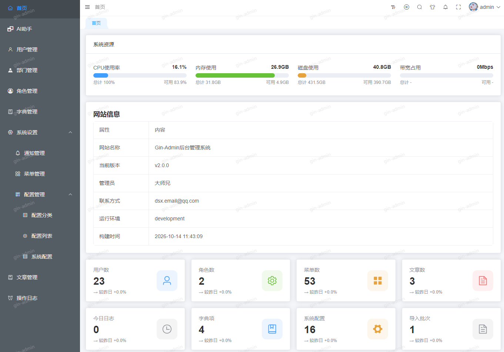
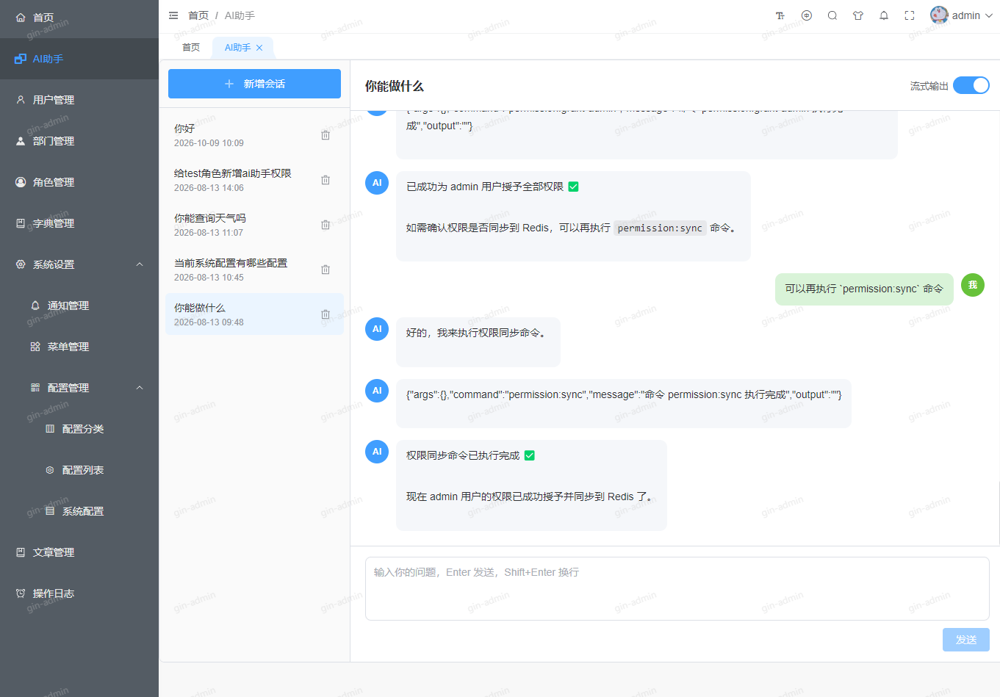
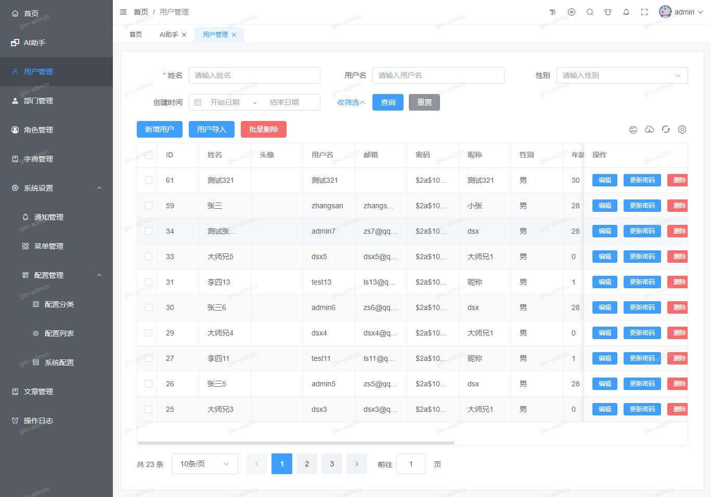
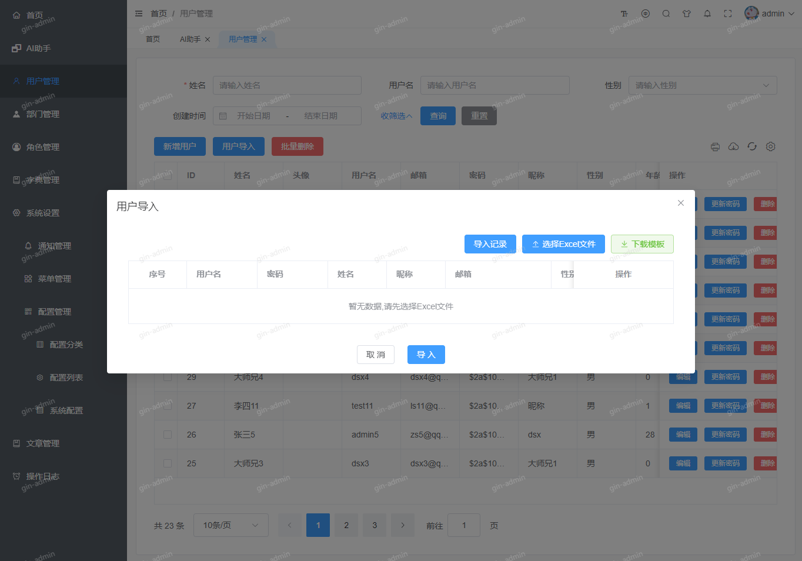
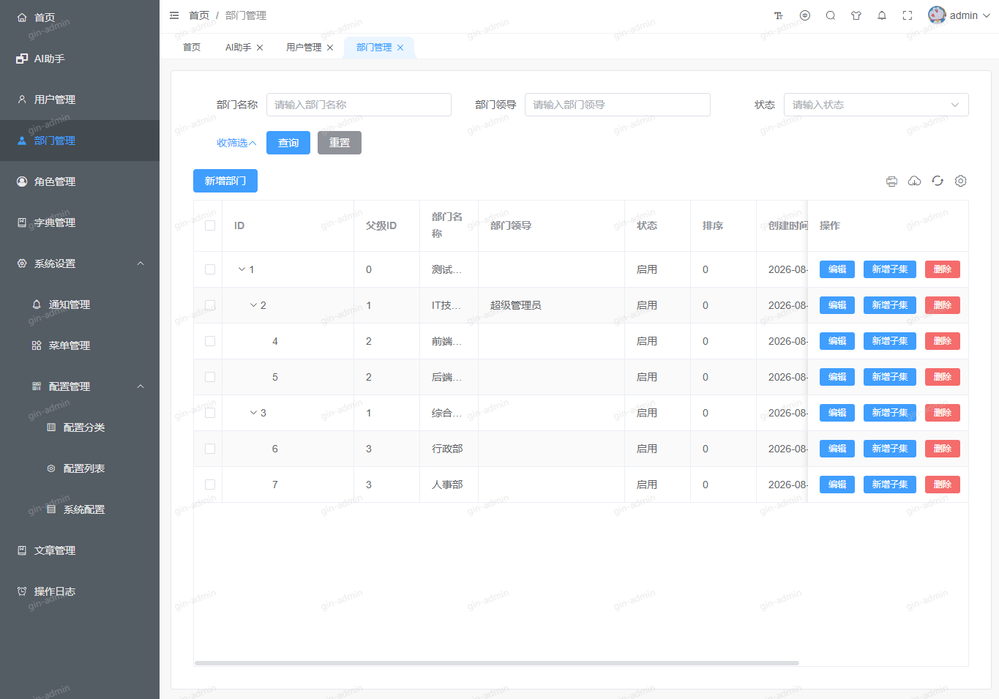
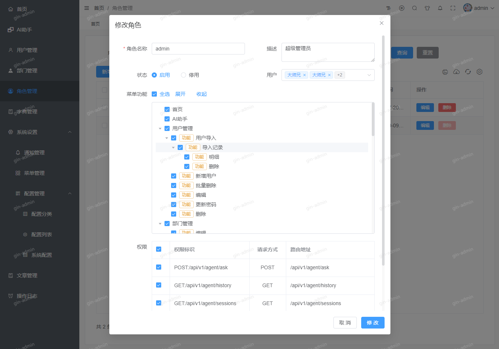
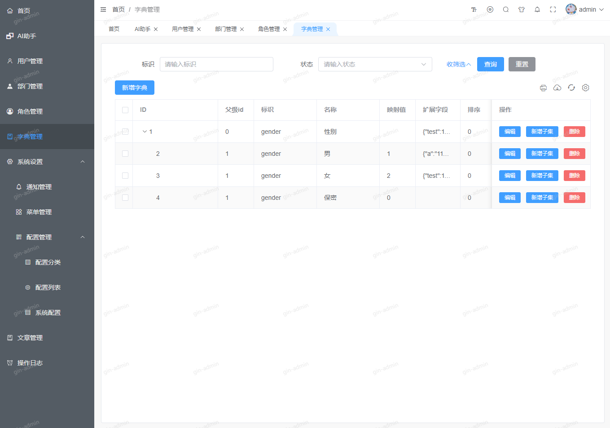
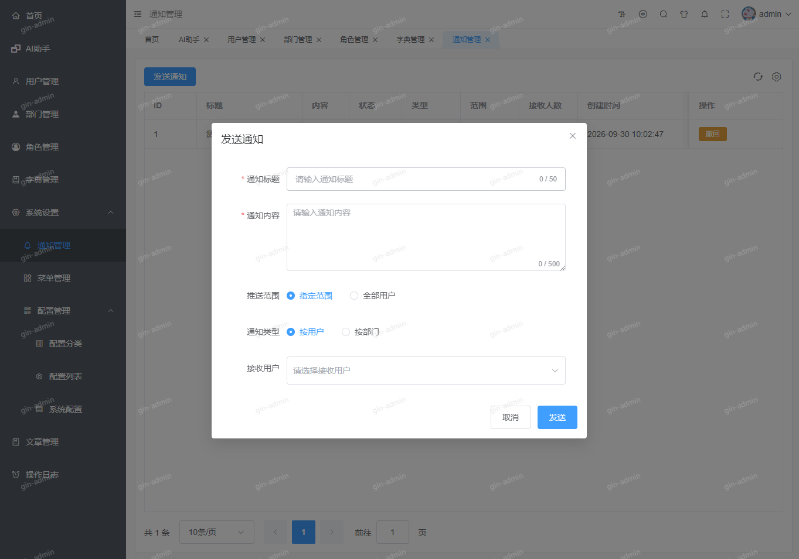
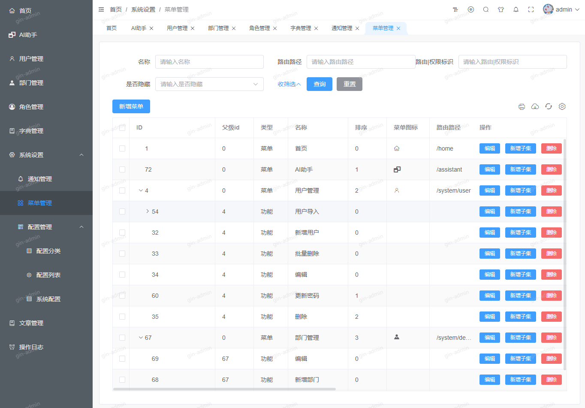
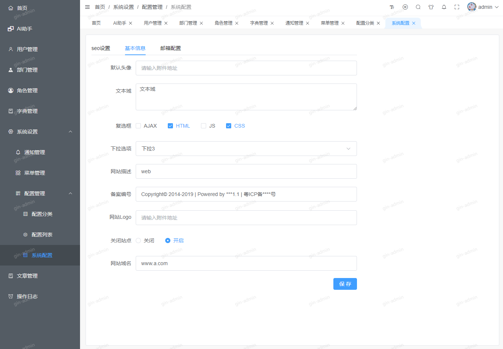
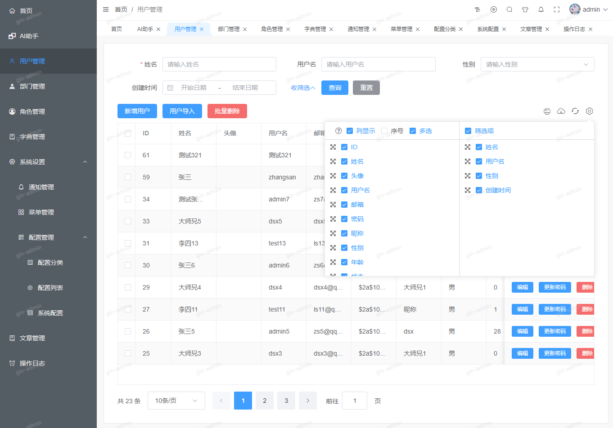
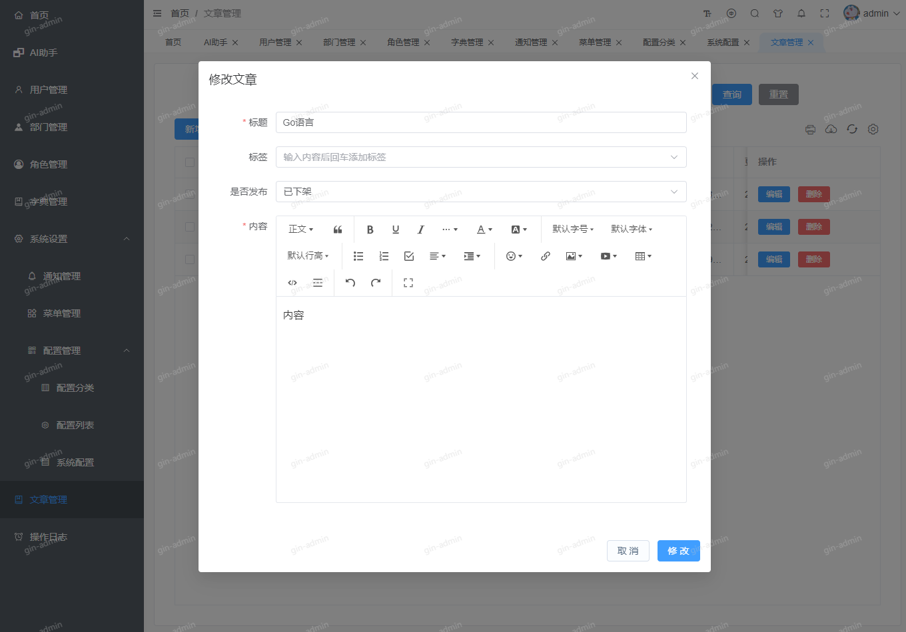
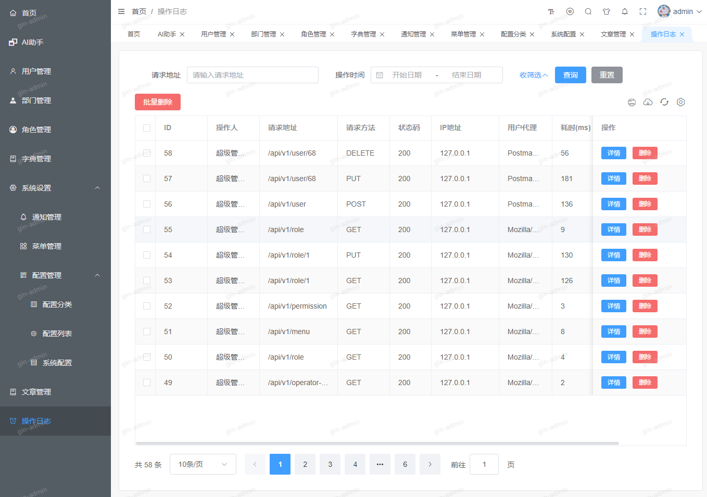

## ✨ 功能特性
- **多布局模式** — 默认、经典、横向、分栏四种布局一键切换
- **主题定制** — 主色切换、深色模式、导航栏渐变、灰色/色弱模式、背景水印
- **多语言国际化** — 简体中文、繁体中文、英文
- **AI 智能助手** — 基于会话的对话界面，支持流式输出（SSE）与普通模式切换；内置 MCP 工具调用，可查询部门、字典、系统配置、用户与操作日志统计，设置角色权限，执行生成控制器/模型/服务/文档、同步权限、查看路由等 CLI 命令；支持新增会话、查看历史与删除会话
- **实时消息通知** — 基于 WebSocket 的站内通知：未读角标、实时推送与撤回、标记已读、发送通知，登录凭证过期自动刷新后重连
- **后端控制路由** — 根据服务端菜单与权限动态生成路由
- **按钮级权限** — 菜单功能点生成按钮权限，统一由 AuthButton 控制显隐
- **用户管理** — 增删改、批量删除、重置密码、Excel 导入与导入记录、主部门与用户部门
- **部门管理** — 部门树维护
- **角色管理** — 菜单权限分配与用户绑定
- **字典管理** — 字典与字典子项维护
- **系统管理** — 菜单（含按钮功能点）、系统参数与参数分类
- **操作日志** — 操作明细查询与删除
- **文章管理** — WangEditor 富文本文章增删改查
- **数据仪表盘** — 资源与站点信息、统计卡片、今日统计概览，以及每小时请求量、状态码分布、请求方法分布、耗时分布等 ECharts 图表和最新操作日志
- **TagsView 标签页** — 支持拖拽排序、缓存、共享
- **多方式登录** — 账号密码登录（图形验证码）、手机号登录
- **自动锁屏** — 超时自动锁定屏幕
- **导出与打印** — 表格导出 Excel、Print.js 打印、用户 Excel 导入
- **响应式适配** — 移动端适配，集成 vConsole 调试

## 🛠️ 技术栈
| 类别          | 技术                              |
|---------------|-----------------------------------|
| 框架          | Vue 3.5（Composition API + `<script setup>`） |
| 构建工具      | Vite 6                            |
| UI 库         | Element Plus 2                    |
| 状态管理      | Pinia 3                           |
| 路由          | Vue Router 4                      |
| 国际化        | vue-i18n 11                       |
| 图表          | ECharts 6 + vue-echarts 7         |
| HTTP 客户端   | 原生 Fetch API                    |
| 实时通信      | 原生 WebSocket                    |
| 富文本        | WangEditor 5                      |
| Markdown 渲染 | markdown-it 15                    |
| 导出 / 打印 / 导入 | js-table2excel、print-js、read-excel-file |
| CSS 预处理器  | Sass / Less                       |
| 图标          | Element Plus Icons                |

## 📦 项目结构
```
gin-web
├── api/                  # API 接口定义
│   ├── article/
│   ├── configCategory/
│   ├── dict/
│   ├── login/
│   ├── menu/
│   ├── role/
│   ├── systemConfig/
│   └── user/
├── components/           # 公共组件
│   ├── authButton/
│   ├── cropper/
│   ├── datePicker/
│   ├── editor/
│   ├── form/
│   ├── iconSelector/
│   ├── svgIcon/
│   ├── table/
│   └── wangEditor/
├── layouts/              # 布局组件
│   ├── component/
│   ├── footer/
│   ├── lockScreen/
│   ├── logo/
│   ├── main/
│   ├── navBars/
│   ├── navMenu/
│   ├── routerView/
│   ├── sponsors/
│   └── upgrade/
├── router/               # 路由配置
│   ├── index.js          # 路由实例与守卫
│   ├── route.js          # 静态路由
│   └── backEnd.js        # 后端控制路由
├── stores/               # Pinia 状态库
│   ├── themeConfig.js    # 主题与布局配置
│   ├── userInfo.js       # 用户信息
│   ├── routesList.js     # 动态路由列表
│   ├── tagsViewRoutes.js # TagsView 缓存
│   ├── keepAliveNames.js # 页面缓存
│   └── requestOldRoutes.js
├── static/               # 静态资源
│   ├── assets/
│   ├── i18n/             # 国际化文件
│   └── menu/
├── theme/                # 主题样式
├── utils/                # 工具函数
├── views/                # 页面视图
│   ├── agent/
│   ├── article/
│   ├── department/
│   ├── dic/
│   ├── home/
│   ├── login/
│   ├── operator_log/
│   ├── role/
│   ├── user/
│   ├── system/
│   │   ├── config/
│   │   ├── menu/
│   │   └── notification/
│   └── error/            # 401、404 页面
├── App.vue
├── main.js               # 应用入口
├── index.html
├── vite.config.js        # Vite 配置
└── package.json
```

## 🚀 快速开始

### 环境要求
- **Node.js** >= v18（推荐 v22+）
- **npm** >= 9

### 安装
```bash
# 克隆仓库 https://gitee.com/dsxwk/gin-web.git 
git clone https://github.com/dsxwk/gin-web.git 
cd gin-web
cp .env.development.example .env.development

# 安装依赖
npm install
```

### 开发
```bash
# 启动开发服务器（加载 .env.development）
npm run dev
```

默认访问地址：`http://localhost:3000`

### 生产构建
```bash
# 开发环境构建
npm run build

# 生产环境构建
npm run build-production

# 预览构建产物
npm run preview
```

## ⚙️ 环境变量
通过 `.env.development` 配置：

| 变量                | 说明                              | 默认值                       |
|---------------------|-----------------------------------|------------------------------|
| `VITE_API_URL`      | 后端 API 地址                     | `http://127.0.0.1:8080/api/v1` |
| `VITE_PORT`         | 开发服务器端口                     | `3000`                       |
| `VITE_ROUTER_MODE`  | 路由模式 `history` 或 `hash`      | `history`                    |
| `VITE_PUBLIC_PATH`  | 生产环境公共路径                   | `/web/`                      |
| `VITE_OPEN_CDN`     | 生产构建是否开启 CDN               | `true`                       |
| `VITE_TOKEN_NAME`   | Token 键名                        | `token`                      |
| `VITE_V_CONSOLE`    | 移动端是否启用 vConsole            | `true`                       |
| `VITE_OPEN`         | 开发启动时自动打开浏览器            | `true`                       |

## 📋 版本记录
> - 最新版本 [v2.1.5](version_history_zh.md#v215) 
> - [历史版本记录](version_history_zh.md)

## 🔗 后端
前端与 **Go/Gin** 后端通信。后端部署请参考：

- [gin-admin (GitHub)](https://github.com/dsxwk/gin-admin.git)
- [gin-admin (Gitee)](https://gitee.com/dsxwk/gin-admin.git)

默认 API 地址：`http://127.0.0.1:8080/api/v1`

## 📄 许可证
[MIT](LICENSE)


